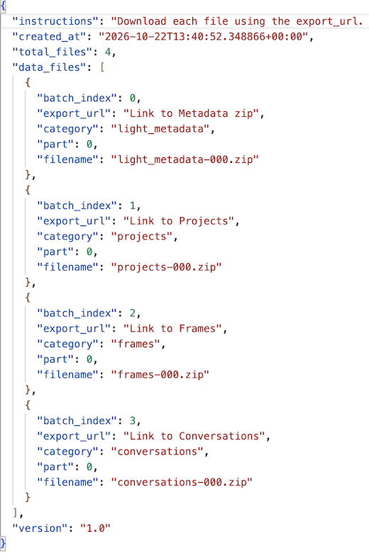

# WashU Claude Edu Guide
WashU will pay for your Claude subscription. Here is a quick guide that covers how to get this subscription for free and how to port over your existing Claude chats (if you already have an account).

### Why go through WashU:
1. It is ✨free✨ for students.
2. Whatever you do in WashU's enterprise account **will not be included in Claude's training data going forward.**
   
### If you are a student:
First, go to this link: https://it.washu.edu/claude-for-education/#newusers
You must first complete a Canvas module that deals with AI literacy. The link is on the page above ("AI Literacy Canvas Module"), or you can follow this link to enroll: https://wustl.instructure.com/enroll/TLC4NB

After successfully completing this course, you will need to wait a few hours. You will then get an e-mail welcoming you to WashU Claude Edu. You must accept the responsible use acknowledgement. 

You will then get an email saying you've been added to Claude edu. Go ahead and sign in with your WashU credentials - you are now using Claude for free!

### Porting over Data from Personal to WashU Claude
If you already have a Claude subscription and wish to retain your old chats, do the following:
1. In your personal account, go to Settings > Privacy > Export Data
2. You will receive an e-mail from Anthropic with a .json file containing your data.
3. This .json file contains 4 links, and will look like this.
   
   

5. Each of these links when opened will automatically download a .zip file with the respective data
6. Drop these .zip files into your WashU Claude, and it can now access your old chats

Note: cancelling your personal Claude account and deleting your personal Claude account are *not* the same thing. Cancelling the subscription leaves your old chats and data intact and allows you access to the free Claude tier, deleting the account removes your personal account completely.
